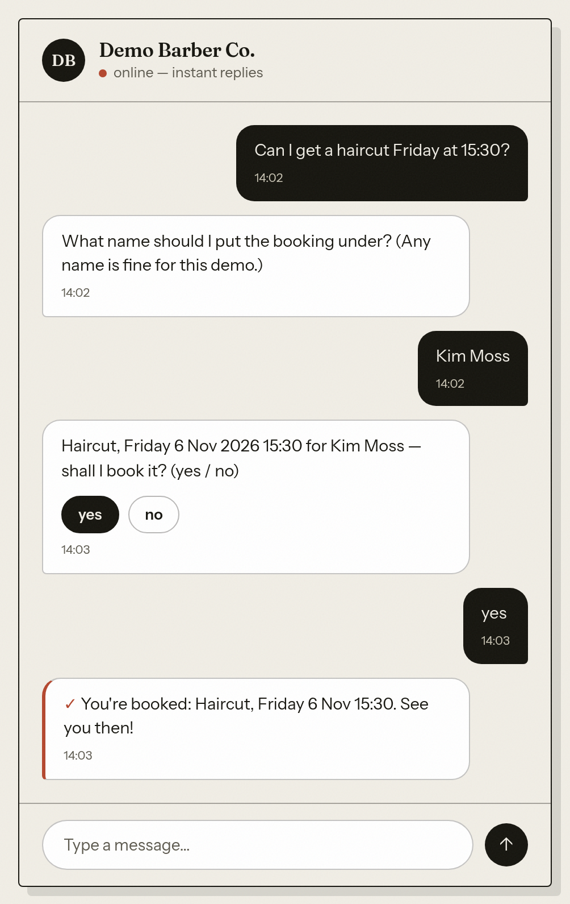

# salon-booking-bot

**A salon booking chatbot that turns a customer's free-text message into a confirmed calendar appointment. An LLM
reads the message; deterministic rules make every decision.**


**Live demo:** the **Website** link in the About box at the top right of this GitHub page. The salon, its services and
its prices are mock data. The engine behind the chat is the real one.



*The homepage's scripted sample conversation, not a live chat. Its bot lines are the engine's own text, checked by
`scripts/check-hero-engine-text.cjs`. It leaves the name out: a real booking asks for one when it is missing and adds
it to the confirm. Captured headless from the live page on 2026-11-04; nothing was sent.*

> **Honest status:** a **demo / learning build** with no paying client and no real customers; the public demo went
> live on 2026-11-01 ([`docs/PUBLIC-DEMO-PLAN.md`](docs/PUBLIC-DEMO-PLAN.md), "GO-LIVE"). Every claim and count on
> this page points to a committed record, and the records label which results are write-ups of live measurements whose
> raw output is not committed and which are statements by the reviewer who made a dashboard change.

## Try this

1. **Book an appointment.** Type *"I'd like a haircut on Wednesday at 11:00"*. The bot asks for a name (a made-up one
   is fine), then shows the booking with its full date and year and asks *yes / no*. A *yes* writes a real event on
   the demo's own Google Calendar. *"cancel my haircut"*, followed by a *yes*, removes it again.
2. **Say "no" at the confirm.** Nothing is booked, and the bot asks what you want to change. A second *no* closes the
   request. A *no* never turns into a cancel of some other booking
   ([`docs/N1-CONFIRM-NO-PLAN.md`](docs/N1-CONFIRM-NO-PLAN.md)).
3. **Give a calendar date, or a weekday that does not match it.** For example *"4 November at 11:00"*, using any date
   in the next 30 days. The engine, not the model, works out the day. If the weekday and the date disagree, the bot
   names both and asks which one you meant; it never guesses
   ([`docs/DATE-PHRASING-PLAN.md`](docs/DATE-PHRASING-PLAN.md) §2).

## How it works

```
 web widget ─┐                                       every external call has a visible error branch:
 WhatsApp* ──┴─► NORMALIZE {channel, sender_key, text}    distinct error flag + owner alert (Telegram)
                   │
                   ▼
   bot check (Turnstile, widget) ─► claim the message id (a duplicate is answered once, never rebooked)
                   │
                   ▼
   load conversation state (Postgres) ─► guards BEFORE any paid call:
                   │                      handoff lock · kill-switch · max turns · monthly spend cap
                   ▼
   LLM ──► intent JSON {intent, confidence, slots}      the model's ONLY job: understanding
                   │
                   ▼
   validate against the committed JSON Schema ─► unsure → ask once, then a human
                   │                             malformed → a human, or one re-ask + owner alert
                   ▼
   resolve the date in code (shop timezone, 30-day horizon) ─► deterministic route (IF / Switch)
                   │
        ┌──────────┼───────────────┬──────────────────┐
        ▼          ▼               ▼                  ▼
   FAQ from    collect service,  cancel /         lead + human
   config      day, time, name   reschedule       handoff
                   │
                   ▼
   CONFIRM GATE: "Haircut, Wednesday 4 Nov 2026 11:00 for <name> — shall I book it? (yes / no)"
        yes ─► calendar write ─► re-read the slot ─► lost a race? withdraw OUR event, hand off
                                                   ─► won: mirror the booking to Postgres
        no  ─► nothing booked; "what would you like to change?"
```

\* *The WhatsApp adapter is built but its inbound webhook is closed for spend safety. It is not tested end to end on
the current store (see "Honest limits").*

**The LLM has exactly one job: understanding.** It turns messy text into a structured intent. It never writes the
customer-facing answer, never chooses an action and holds no write permission. Prices, hours and services come from
config, and routing is `IF` / `Switch`. That is why the bot **cannot quote a wrong price**: there is no model on the
answer path.

## Stack

n8n (self-hosted, the engine) · Anthropic Claude Haiku 4.5 (structured output, temperature 0) · PostgreSQL
(self-hosted) · Google Calendar · Next.js on Vercel (the demo site) and an embeddable widget (one script tag, Shadow
DOM) · a Next.js owner dashboard behind Cloudflare Access · Cloudflare (Turnstile, the edge rate limit, the tunnel) ·
Telegram (owner alerts) · Zernio (the WhatsApp Business API adapter).

## Real vs demo

| Real | Demo |
|---|---|
| The engine: n8n and Postgres, self-hosted on one server, with a nightly backup that is restored and compared before it counts ([`db/ops/pg-backup.sh`](db/ops/pg-backup.sh)) | The salon: its name, services, prices and hours are a mock config ([`config/client.config.example.json`](config/client.config.example.json)) |
| Google Calendar: bookings are real events on the demo's own calendar | Customers: none. Tests use synthetic names only |
| LLM calls: real, paid, and behind a spend cap | The site: marked as a demo (a "Mock" ribbon and footer, `noindex`) |
| The site on Vercel: only its custom domain is public; the other Vercel addresses redirect to a login or do not exist | The WhatsApp lane: built but closed (see below) |
| Owner alerts: real Telegram messages | A second client: the config-only render is shown offline only ([`docs/PHASE-8-PLAN.md`](docs/PHASE-8-PLAN.md)) |

## Safety and spend brakes

- **Bot check:** Cloudflare Turnstile in *Managed* mode, set to interaction-only. The checkbox appears only when
  Cloudflare asks for it. The engine verifies every token, and a fake token gets 403 (`docs/PUBLIC-DEMO-PLAN.md`,
  "DOMAIN + INTERACTION-ONLY").
- **Edge rate limit:** a Cloudflare rule allows 30 requests per 10 s per IP and data centre on the webhook path. Above
  that it blocks for 10 s, and the block was shown before go-live (`docs/PUBLIC-DEMO-PLAN.md`, R2c).
- **Spend cap, fail-closed:** a monthly LLM cap is checked before every paid call. If the spend meter cannot be read,
  no model is called: the customer gets a polite handoff reply and the owner gets a `spend_meter_unavailable` alert
  (`Eval Spend` in [`n8n/workflow.main.sanitized.json`](n8n/workflow.main.sanitized.json); ruling (d) in
  [`docs/ARCHITECTURE-DECISIONS.md`](docs/ARCHITECTURE-DECISIONS.md)).
- **Kill-switch and max turns:** the kill-switch makes the bot handoff-only, and the turn cap ends a runaway
  conversation. Both trip before any LLM call, so a tripped guard costs nothing
  ([`.claude/rules/spend-safety.md`](.claude/rules/spend-safety.md)).
- **Pause:** the site can be paused on Vercel, which then answers 503 with a "paused" marker. This was drilled before
  go-live (`docs/PUBLIC-DEMO-PLAN.md`, R2f).
- **Privacy:** a `/privacy` page (GDPR) names the controller and the contact, the legal basis (Art. 6(1)(f)), retention
  (leads 30 days, deleted by a nightly purge with a fail-closed safety limit), the data subject's rights and the right to complain. Both identity
  values are build-time settings and never sit in this public repo
  ([`web/site/app/privacy/page.tsx`](web/site/app/privacy/page.tsx)).
- **Public repo hygiene:** no secret and no customer data in git; only sanitized workflow exports are committed. A
  secret scan runs on every push, and a host-leak guard fails the checks if a private hostname appears in a tracked
  file.

## How it was tested and reviewed

- **`check-all`** ([`scripts/package.json`](scripts/package.json)) is run before every push by procedure (the git
  pre-push hook itself runs the secret scan): the unit suites, the
  contract drift checks (the validator is generated from the schema), the SQL-parameter gate and the deploy tools'
  self-tests.
- **Chat replay:** whole conversations are replayed offline through the exported workflow
  ([`tests/unit/chat-replay.lib.cjs`](tests/unit/chat-replay.lib.cjs)). The code nodes run for real; the database,
  calendar and LLM are stubbed, and the model's answer is given. The harness was added after a live run found a date
  wording that every unit test had missed (see the case study).
- **Mutation tests:** a guarded behaviour gets a file of deliberate breakages, and each one must turn its test red. For
  example, the decline path has 39 ([`tests/unit/n1-confirm-no-mutants.py`](tests/unit/n1-confirm-no-mutants.py)).
  *A test that cannot go red proves nothing.*
- **Intent and injection cases:** 30 golden cases ([`tests/golden-set.md`](tests/golden-set.md)) and 12 jailbreak /
  prompt-injection cases ([`tests/jailbreak-cases.md`](tests/jailbreak-cases.md)).
- **Independent audit:** Codex, a second tool that did not write the code, audits named high-risk targets:
  idempotency, the booking race, secrets, error visibility, date resolution and others. The prompts and the raw
  outputs are committed verbatim under [`docs/codex/`](docs/codex/), and each finding is triaged in its plan.
- **Owner live runs:** the three features added after go-live (the name, the date wording, the "no") each closed with
  a run in a real browser with a real Turnstile token. Each run was then read back from the execution log and the
  database (each plan's last round, e.g. [`docs/N1-CONFIRM-NO-PLAN.md`](docs/N1-CONFIRM-NO-PLAN.md), "R4").

## How this was built

Several tools and one person, each with a named job ([`CLAUDE.md`](CLAUDE.md), "Defense-in-depth"):
- **Architecture and review — in Cowork**, a separate AI workspace that reads this repository from git. It drafted
  round briefs and reviewed the results. Some dashboard settings (Cloudflare, Vercel) were changed there too,
  and the records label those as Cowork's statements, not as measurements.
- **Implementation — by Claude Code**, which wrote the workflows, the frontends, the guards, the tests and these docs,
  and ran the repository's own review agents (`security-auditor` before every push).
- **Independent audits — by Codex**, a second tool that did not write the code. Its prompts and raw answers are committed
  under [`docs/codex/`](docs/codex/).
- **Live runs in a real browser** with a real Turnstile token — something the build machine's headless browser cannot
  get. The owner ran them; N1's run was carried out by Cowork at his request
  ([`docs/N1-CONFIRM-NO-PLAN.md`](docs/N1-CONFIRM-NO-PLAN.md), "R4").
- **The owner audits and rules.** He does not build. Every phase starts only on his written approval of its plan and
  closes on his ruling, and the decisions a plan leaves open are his
  ([`CLAUDE.md`](CLAUDE.md), "CC BUILDS. YIGITCAN AUDITS AND RULES";
  [`.claude/rules/plan-gate.md`](.claude/rules/plan-gate.md)).

## Honest limits and what comes next

- **No real customers, no paying client.** It is a portfolio build on mock config.
- **WhatsApp is not tested end to end on Postgres.** The lane was proven live once, before the store moved; its webhook
  stays closed for spend safety.
- **The booking race is bounded, not locked.** There is no lock across Postgres and the calendar. A truly simultaneous
  pair for one slot can both withdraw, so nobody is booked and a human follows up. If the re-read itself fails, two
  events can remain, and the owner is alerted to cancel one
  ([`.claude/rules/booking-integrity.md`](.claude/rules/booking-integrity.md)).
- **Widget identity has session strength, not a verified identity.** A customer can only reach their own booking, keyed
  by the channel's sender, but on the widget that key comes from the browser session.
- **Dates:** English only, no ranges ("early next week"), and a 30-day booking horizon.
- **A "yes" counts on the turn right after its confirm — among saved turns.** A turn that saves no state (an outage
  reply, a guard trip) does not stale the confirm, so the next "yes" books the slot shown; the cancel and reschedule
  confirms share the bound ([`docs/CLOSE-OUT-PLAN.md`](docs/CLOSE-OUT-PLAN.md), "R2").
- **A second client is shown offline only.** A config file and its secrets render a second client's workflows with no
  hand edit, but this has not yet run on a real second deployment.
- **The full v2 list and every recorded bound:** [`docs/ENGINEERING-NOTES.md`](docs/ENGINEERING-NOTES.md) and the live
  [`docs/ROADMAP.md`](docs/ROADMAP.md).

---

## What works today ✅

| Capability | Detail |
|---|---|
| **Multi-channel intake** | WhatsApp + widget shapes normalized to one internal format; channels toggle in config |
| **Conversation memory** | Per-sender state in Postgres (`salon.conversations`: `stage`, slots, turn count) — survives restarts |
| **Intent understanding** | Claude Haiku 4.5, temperature 0, native structured outputs |
| **Contract validation** | Model output validated by an ajv validator **compiled from the committed schema** — no hand-written copy that can drift |
| **Multi-turn booking** | Service, day, time and the customer's name are collected over several turns and confirmed together; the calendar event's title carries the name ([`docs/NAME-CAPTURE-PLAN.md`](docs/NAME-CAPTURE-PLAN.md)) |
| **Dates resolved in code** | weekday words, calendar dates (`4 November`) and numeric forms (`4.11.`), in the shop's timezone, with the year in the confirm and a 30-day horizon; a wrong weekday or an impossible date is asked back, never guessed ([`docs/DATE-PHRASING-PLAN.md`](docs/DATE-PHRASING-PLAN.md)) |
| **A "no" at the confirm** | nothing booked, the details kept, "what would you like to change?"; a second "no" closes the request ([`docs/N1-CONFIRM-NO-PLAN.md`](docs/N1-CONFIRM-NO-PLAN.md)) |
| **Deterministic FAQ** | Price / hours / services / address answered from config, never from the model |
| **Lead capture** | Non-booking interest written to Postgres (`salon.leads`) with channel + message; deleted after 30 days by the scheduled purge, which deletes nothing on a night when it would remove more than a fifth or more than 200 at once, or when fewer than five are stored (fail-closed; the owner is alerted) |
| **Human handoff, 5 distinct classes** | guard-trip (transient) · infrastructure down (an error flag + owner alert; 503 only before the message is claimed) · genuine handoff (writes state) · clarify (first uncertain turn, no lock) · extraction-transient (our schema broke, owner alerted, no lock) — never merged ([`.claude/rules/handoff.md`](.claude/rules/handoff.md)) |
| **Visible failures** | Distinct machine-side error flags, never dressed as a normal reply — e.g. `invalid_payload` · `state_unavailable` · `llm_unavailable` · `lead_unavailable` · `calendar_unavailable` · `spend_meter_unavailable` |
| **Booking without double-booking** | Calendar first, then re-read the slot; on a lost race the bot withdraws ITS OWN event and hands off, and only a won slot is mirrored to Postgres. A message delivered twice is answered once: the message id is CLAIMED at the start of the turn on a UNIQUE column, so two deliveries cannot both claim it (claim-first; CRT 1a closed in 7-2). The cost is at-most-once — a run that dies after its claim is not retried. See [booking-integrity](.claude/rules/booking-integrity.md) for that and the booking race it does not close |
| **Cancel · reschedule · reminders** | Bot-automated, identity-bound to the channel's `sender_key`. Reminders are proven in dry-run; live WhatsApp template delivery needs the client's own WhatsApp Business number |
| **Owner dashboard** | Read-only panels + the handoff queue + one write (release a handoff lock, through a protected n8n path). Runs on the build server behind Cloudflare Access and reads Postgres as a SELECT-only role. It runs as a systemd user unit (`ops/systemd/salon-dashboard.service`) that restarts it on a crash (measured, 7-F1); its start at boot is shown by configuration, not by a reboot |
| **Spend brakes before the LLM** | Kill-switch, max-turns and a monthly LLM spend cap run *before* any paid call — a tripped guard costs nothing. The cap fails CLOSED: if the spend meter cannot be read, no model is called, the customer gets a handoff reply and the owner a `spend_meter_unavailable` alert. A deployment with no cap configured is never blocked by it |
| **Embeddable widget, one script tag** | A single self-contained IIFE (well under 20 kB; `npm run build -w @salon/snippet --prefix web` prints the current size) that mounts a booking chat inside a Shadow DOM on someone else's site. Isolation measured in both directions against a deliberately hostile host page — see the case study ([docs/CASE-STUDY.md](docs/CASE-STUDY.md) §9), including what it knowingly does not do |
| **Public demo** | The Next.js site on Vercel, only its custom domain public, with the chat, a `/privacy` page and the Turnstile check ([`docs/PUBLIC-DEMO-PLAN.md`](docs/PUBLIC-DEMO-PLAN.md)) |

## Not built yet 🔜

A **real second deployment** (Phase 8 proves the config-only render offline, on a mock client) · **per-client Turnstile
provisioning**, which must exist before the second real client: every client needs its own widget, created by the
Cloudflare API, with its secret landing in that client's credential store and never in a transcript
([`docs/ROADMAP.md`](docs/ROADMAP.md), public-demo row) · the **WhatsApp lane end to end** on the current store.

**Deferred to v2, and every recorded bound** — moved verbatim to [`docs/ENGINEERING-NOTES.md`](docs/ENGINEERING-NOTES.md) (2026-11-03).

---

## Engineering decisions worth reading

**Deterministic before AI.** A model is used only where a rule genuinely cannot decide. Asking an LLM
"what does a haircut cost?" is slower, costlier and less reliable than reading one config field.

**The schema is the single source of truth.** The validator inside the flow is *generated* from
`schemas/intent.schema.json` by a script, with a drift check. Two hand-maintained copies of the same
contract always diverge; a generated one cannot.

**Never trust a 200.** Structured output is only guaranteed when the model stops normally, so
`stop_reason` is checked first, enum casing is normalized, and any unexpected shape becomes a handoff
instead of a crash.

**An outage must not look like a handoff.** If the LLM or the database is down the customer still gets a
polite message, but the machine-side response is distinct (an error flag, and an owner alert) so the owner
knows. Once the message is claimed the status is 200, because a 5xx would only make the channel retry a message that
is already claimed; before the claim it is 503. An outage that looks normal is an outage nobody fixes.

**Availability has one source of truth.** Google Calendar owns free/busy; Postgres mirrors it. Writes go
to the calendar first. Two sources of truth mean double bookings — and Postgres's transactions do not change
that, because the calendar write is an HTTP call outside them.

**Safety over liveness: a truly simultaneous pair withdraws both.** Each writer books, re-reads and yields if it sees
another event, so two requests at the same moment can both yield: no double booking, no booking, a human follows up.

**The date is the engine's, not the model's.** The model passes the customer's own words (`dateExpr`); `Resolve Date`
turns them into a day in the shop's timezone, and the model's own date is only a disagreement signal. The model once
answered a Saturday for "friday morning" at confidence 0.92, and no confidence threshold catches that. The confirm
shows the full date with its year, so the last check is the customer's own eyes
([`docs/DATE-PHRASING-PLAN.md`](docs/DATE-PHRASING-PLAN.md), "R2d").

**Config / code / secret are separate — shown offline, with its bounds.** A new client = a config file + secret inputs
→ `scripts/render-client.py` → import into its own n8n; no node edited by hand. Shown on a fictional second client
(`tests/unit/render-client.test.py`), with bounds stated in the same breath: EUR only, customer text in English, two
config keys that drive nothing, credentials linked by hand, and not yet a real second deployment. The full statement is
in [`docs/ENGINEERING-NOTES.md`](docs/ENGINEERING-NOTES.md) and [`docs/PHASE-8-PLAN.md`](docs/PHASE-8-PLAN.md).

---

## Case study

**[docs/CASE-STUDY.md](docs/CASE-STUDY.md)**: the problem, the approach, the architecture (the LLM as a translator),
the AI-versus-deterministic split, the Airtable → Postgres migration, the independent Codex audit and its triage,
going public, the three defects the live runs found after it (the name, the date wording, the "no"), what I learned,
and what "one swap to real" does not yet mean. The embeddable widget's case study is its §9.

---

## Repo map

| Path | What |
|---|---|
| [`n8n/`](n8n/) | the engine — **sanitized** workflow exports only: one `workflow.<key>.sanitized.json` per live Postgres workflow (five), listed with its id in `scripts/check-exports-parity.sh`; the Airtable originals' exports were removed at D6c and stay in git history |
| [`db/`](db/) | `schema/` — the Postgres DDL, roles and the large-object revoke · `ops/` — the nightly backup and its restore check |
| [`schemas/`](schemas/) | JSON Schemas — the intent contract and the client config contract |
| [`prompts/`](prompts/) | versioned LLM prompts (the canonical system prompt) |
| [`scripts/`](scripts/) | validator compiler + drift check · the SQL-parameter gate · workflow deploy / parity guards · the client render · repo map generator |
| [`config/`](config/) | per-client `client.config.json` (mock examples committed) |
| [`docs/`](docs/) | architecture decisions · data model · live roadmap · each feature's plan and rounds · engineering notes · repo map |
| [`design/`](design/) | Phase-1 mockups + flow diagram |
| [`tests/`](tests/) | golden-set intents · jailbreak / injection cases · `unit/` — the suites, the chat-replay harness and the mutant files |
| [`web/`](web/) | frontend surfaces — `site/` (the Next.js demo on Vercel), `snippet/` (the embeddable widget), `shared/` (one transport, both front ends), `dashboard/` (the owner dashboard) |
| [`.claude/`](.claude/) | the rules this repo is actually built under |

---

## Security

This repository is **public**, so it is built as if it were.

- No secrets, no customer PII in git — real values live in n8n Credentials and the hosting platform's environment.
  Only sanitized n8n exports (`n8n/*.sanitized.json`) are committed; credential, base and calendar ids are
  placeholders.
- Every push runs a secret/PII scan.
- The n8n editor is never exposed to the internet; only webhook endpoints are.
- The owner dashboard shows PII, so it sits behind Cloudflare Access: measured 2026-10-24, a request without a
  session is redirected to the Access login, and the policy admits one named email
  ([MIGRATION-PLAN §3t, K-6](docs/MIGRATION-PLAN.md)). CRT #9 (dashboard auth) is audited and its findings
  addressed (`[x]`, 7-2) in [MASTER-BRIEF §9](MASTER-BRIEF.md).
- The store's own boundary: n8n's database role has DML on the five tables plus their sequences and two helper functions (default privileges extend that to tables the owner adds later), the dashboard's role
  has SELECT only ([`db/schema/002_roles.sql`](db/schema/002_roles.sql)), and every workflow query is parameterised
  (`scripts/check-sql-params.py`). The database port is not reachable from outside *(operator statement,
  MIGRATION-PLAN §3t, A9)*.
- **The security pass's open items and the recorded honest limits** (the date guard's history, the extraction-retry path, cancel identity) — moved verbatim to [`docs/ENGINEERING-NOTES.md`](docs/ENGINEERING-NOTES.md).

---

## From demo to real

The demo runs the real engine on a mock config. Going live for a client means their real WhatsApp number, their
calendar and **their own Postgres**. Under Model 1 (one isolated deployment per client) that is a Postgres service, its
secrets and its backup step per client ([MIGRATION-PLAN §8](docs/MIGRATION-PLAN.md)), plus the client's own Turnstile
widget. The engine's code does not change; that *only config* changes is shown offline, not yet on a real second
deployment (see "Config / code / secret" above). The operator's runbook — provisioning a client's Postgres, the daily
checks, the backup, deploys — is [`docs/RUNBOOK.md`](docs/RUNBOOK.md); its provisioning section has not yet been run as
one procedure for a new client.

**Why Postgres and not Airtable — kept here because it is the reason.** The free Airtable plan could not serve a
single real client: 1,000 API calls per month per workspace, shared between the bot and the dashboard, plus a hard
5 requests/second per base (measured 2026-09-12). On 2026-10-06 the quota ran out with no customer traffic at all,
and the bot had no data layer for almost twelve days ([OPS-5](docs/OPERATIONAL-INCIDENTS.md)). The store moved to
self-hosted Postgres (ruling 2026-10-19; cut over and accepted 2026-10-24,
[MIGRATION-PLAN §3t](docs/MIGRATION-PLAN.md)). **Airtable was retired at D6c (2026-10-27)**: the original workflows
are archived and n8n's Airtable credential is deleted, so nothing can reach it. Since 2026-11-04 the base is kept (synthetic demo data) and
its token is to be revoked by the owner (CLOSE-OUT C-6, open at this writing). What Postgres costs instead: a
database to run, back up and restore for every client. The nightly backup restores each dump into a throwaway
container and compares every table before the dump counts ([`db/ops/pg-backup.sh`](db/ops/pg-backup.sh)).

---

## Documentation

**[MASTER-BRIEF.md](MASTER-BRIEF.md)** — the current architecture ·
**[docs/ROADMAP.md](docs/ROADMAP.md)** — live phase status ·
**[docs/ARCHITECTURE-DECISIONS.md](docs/ARCHITECTURE-DECISIONS.md)** — every decision and why it changed ·
**[docs/ENGINEERING-NOTES.md](docs/ENGINEERING-NOTES.md)** — the v2 list and every recorded bound ·
**[docs/DATA-MODEL.md](docs/DATA-MODEL.md)** — the Postgres data model ·
**[docs/MIGRATION-PLAN.md](docs/MIGRATION-PLAN.md)** — how the store moved from Airtable to Postgres, step by step ·
**[docs/PUBLIC-DEMO-PLAN.md](docs/PUBLIC-DEMO-PLAN.md)** — going public ·
**[docs/CASE-STUDY.md](docs/CASE-STUDY.md)** — the case study ·
**[docs/RUNBOOK.md](docs/RUNBOOK.md)** — operating a deployment.

MIT licensed. Built by [Neeidy](https://github.com/Neeidy) as a portfolio project in AI automation.
